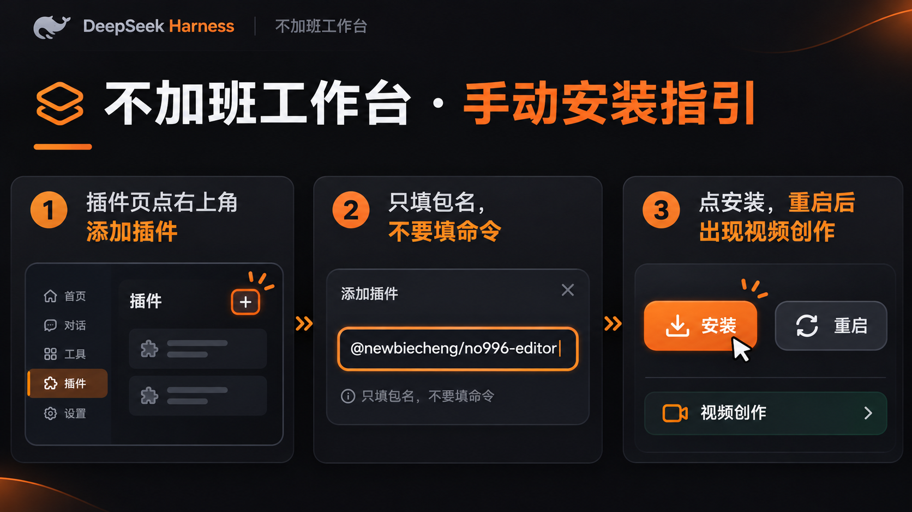

# 不加班工作台 · No996 Editor

不加班工作台是一套面向创作者的 AI 影片剪辑工作台：在 DSH 里打开一个完整的剪辑环境，用对话驱动分镜、剪辑、动效与导出。左侧是时间轴与素材库，右侧是原生 DSH 对话；你说话，它按影片项目执行。

当前版本以 [`package.json`](package.json) 与 [CHANGELOG.md](CHANGELOG.md) 为准；进度看 [docs/STATE.md](docs/STATE.md)。唯一源码仓库：[`NewbieCheng/dsh-no996-editor`](https://github.com/NewbieCheng/dsh-no996-editor)（GitHub，main 分支）；旧仓库 `NewbieCheng/dsh-openfilm` 与 GitLab 均已弃用，不再发布与维护。

## 能做什么

- **对话式剪辑**：一条对话对应一条原生 DSH 会话，同一个项目可开多条互不干扰的会话；模型、审批、取消、流式回答全部走 DSH 原生能力。
- **完整剪辑环境**：时间轴落盘编辑、抽帧、素材库（免费素材检索与取用）、本地模板、预览放映与画布工作台。
- **导演与分镜**：`openfilm_storyboard` 读写 `.film/storyboard.json`，支持 `from-script`、`plan`、`subtitles`；把一句需求变成分镜再落到时间轴。
- **口播与字幕**：`openfilm_transcribe` 本地转写视频/音频为带时间码文稿，字幕 SRT 与画面同步。
- **本地视觉能力**：`openfilm_cutout` 生成单帧人物抠像预览，`openfilm_face_analysis` 返回人脸框与关键点（不识别身份），只处理项目内素材。
- **图片与附件**：模型支持看图时内联发送，否则落成临时文件按路径引用；上传兜底上限 256 MiB。
- **CLI 兜底**：`openfilm_cli` 支持 `doctor` / `version` / `skills` / `skill` 等只读能力。

未接通：余额展示、云端预览/渲染沙箱、macOS/Linux 真机验收。详见 [docs/STATE.md](docs/STATE.md)。

## 安装与更新

包名：`@newbiecheng/no996-editor`，发布在 npmjs.org，公开可装、无需 token。

```powershell
dsh plugin --profile desktop add @newbiecheng/no996-editor
```

或在 DSH 插件管理器按包名安装，之后可在「版本」Tab 检测并一键更新；出现 `restart-required` 时完整重启 DSH。更新前保存未保存的编辑。安装/更新/发版手册见 [`docs/playbooks/publish.md`](docs/playbooks/publish.md)。

### 手动安装（对照界面，3 步）

1. DSH 左侧进「插件」页，点右上角「＋ 添加插件」。
2. 弹框输入框里**只填包名**（不要填整条命令）：
   `@newbiecheng/no996-editor`
3. 安装源保持默认，点「安装」。装完按提示**重启 DSH**，侧栏出现「视频创作」即成功。



**GitLab 已弃用**：旧 GitLab Package Registry 不再发布、不再维护，也不再作为安装源；`npmjs.org` 是唯一包源。

需要：DSH 内核（`session-controller`、`storageDomain`、`webServer`）、Node.js 22.2+、`ffmpeg` / `ffprobe`（视频信息；缺失会在界面提示，不自动安装）。

## 用起来

- 侧栏「视频创作」打开工作台；项目首次打开时 Host 会在项目文件夹写入编辑指令 `AGENTS.md`（已存在则绝不覆盖）。
- 账号走工作台账号，不是任何上游站点账号；未登录由壳内登录页挡住剪辑。`NO996_OPENFILM_DEV=1` 可跳过账号门做开发。
- 工具按需加载：风格库、镜头卡、模板全文、手册都按需读，不进系统提示；常驻上下文预算 ≤ 6 KB。
- 免费素材（CC0）可检索与取用，转场/特效/滤镜/文字由 Host 用库索引检索；生成类服务可能收费，需自行连接并确认。

## 文档

| 文档 | 给谁 | 内容 |
|---|---|---|
| [docs/index.md](docs/index.md) | 所有人 | 文档地图 |
| [AGENTS.md](AGENTS.md) | 智能体 | 红线、改哪一层、生效矩阵、npmjs 发布铁律 |
| [docs/ARCHITECTURE.md](docs/ARCHITECTURE.md) | 开发者 | 进程模型与边界 |
| [docs/DEVELOPMENT.md](docs/DEVELOPMENT.md) | 开发者 | 启动时序、请求路径、构建 |
| [docs/STATE.md](docs/STATE.md) | 所有人 | 唯一写进度的一篇 |
| [docs/playbooks/publish.md](docs/playbooks/publish.md) | 装/更/发的人与智能体 | 安装、更新、发版、回滚（唯一手册） |
| [docs/playbooks/incident.md](docs/playbooks/incident.md) | 排障的人 | 症状 → 根因 → 现在靠什么挡住 |
| [docs/playbooks/incident-history.md](docs/playbooks/incident-history.md) | 追溯历史的人 | 2026-11-19 发布/registry 事故完整复盘 |

专题：[模板](docs/TEMPLATES.md)、[动效](docs/MOTION.md)、[口播转写](docs/TRANSCRIBE.md)、[品牌](docs/BRAND.md)。

## 许可

本产品以 **GNU General Public License v3（或更高版本）** 发布，详见 [LICENSE](LICENSE)。

其中捆绑的第三方开源组件仍受各自许可证约束，见 [vendor/official-shell](vendor/official-shell) 与 `THIRD_PARTY_NOTICES.md`。

基于 OpenFilm 0.4.0 开发。

---

## English summary

No996 Editor is an AI video editing workbench delivered as a DSH plugin: a full editing environment on the left, a native DSH conversation on the right. It supports conversational editing, storyboard planning, timeline editing, transcript and subtitles, free CC0 media, and local person-cutout / face-position tools. Install `@newbiecheng/no996-editor` from npmjs.org. Requires Node 22.2+, a DSH host with native session controller, and ffmpeg/ffprobe. Released under the GNU General Public License v3 or later (see LICENSE). Bundled third-party components keep their own licenses under vendor/official-shell and THIRD_PARTY_NOTICES.md. Based on OpenFilm 0.4.0.
